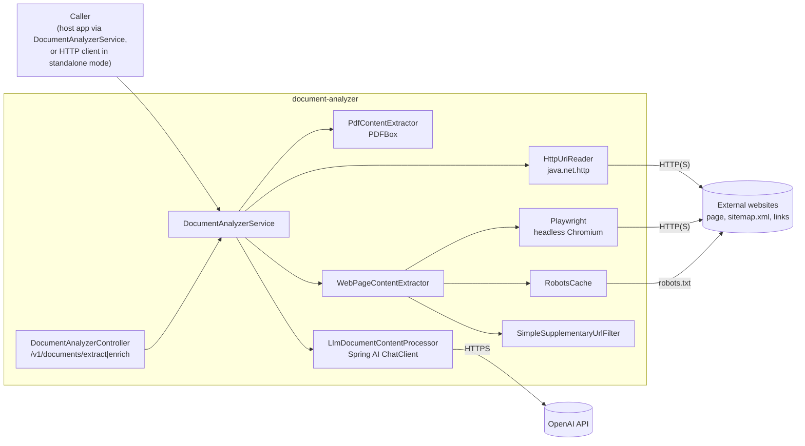

# Document Analyzer — Architecture

## Purpose and scope

**Does**

- Fetches a URL. If the downloaded content is a PDF (`%PDF-` header), the text and metadata are
  extracted with PDFBox. Otherwise the page is rendered in headless Chromium and cleaned, and up to 50 supplementary pages
  from the same site are scraped (from `sitemap.xml` and same-domain links, optionally narrowed by
  `topics`). (`analyze/service/DocumentAnalyzerService#read`,
  `extract/service/WebPageContentExtractor#extractWholeSite`, `MAX_SUPPLEMENTARY_PAGES = 50`)
- Prefers English versions of pages when they're advertised.
  (`HttpUriReader#detectEnglishHtmlVersion`)
- Respects `robots.txt` (bot name `DocumentAnalyzerBot`), `X-Robots-Tag` and `<meta name="robots">`
  `noindex`/`none`. (`RobotsCache`, `HttpUriReader#isNoIndex`, `WebPageContentExtractor#extractFromUrl`)
- Sends the extracted content plus a caller-supplied JSON template to an OpenAI chat model, with the
  configured `system-prompt` as system message, and returns the filled template. (`enrich/service/LlmDocumentContentProcessor#generate`,
  `ContentMetadataRequestBuilder`)
- Fetches only `http`/`https` URLs whose host resolves to a public address, checked on entry, on every
  redirect hop and for every browser request (`UrlGuard`).
- Runs either embedded (Spring Boot auto-configuration) or as a standalone web app exposing two REST
  endpoints.

**Does not**

- Persist anything, cache documents across calls, or queue work. Everything happens synchronously
  within the call. (only `RobotsCache` holds in-memory state)
- Authenticate callers.
- Read local files through the service API. `FileUriReader` exists but `DocumentAnalyzerService` only
  uses `HttpUriReader`.

## Technical stack

| Item | Value | Evidence |
|---|---|---|
| Java | 21 | `pom.xml` |
| Framework | Spring Boot 3.5.15 (web), spring-retry + AspectJ | `pom.xml` |
| LLM | Spring AI 1.1.8 `spring-ai-starter-model-openai`. Default model `gpt-5-mini` (standalone) | `pom.xml`, `document-analyzer.yml` |
| Rendering | Playwright 1.52.0, Chromium headless (`--no-sandbox`), launched on first render | `WebPageContentExtractor#browser` |
| Parsing | jsoup 1.20.1 (HTML), PDFBox 3.0.7 (PDF), crawler-commons 1.4 (sitemaps, robots) | `pom.xml` |
| API docs | springdoc-openapi 2.8.16 (Swagger UI) | `pom.xml` |
| Build / CI | Maven wrapper, `spring-boot-maven-plugin` (`exec` classifier, not attached), JaCoCo, OWASP dependency-check, Jenkins, release-please | `pom.xml`, `Jenkinsfile` |

## Main modules and responsibilities

| Package | Responsibility |
|---|---|
| `analyze.controller` | `DocumentAnalyzerController`: `POST /v1/documents/extract` and `/enrich` (standalone mode only, since it isn't part of the auto-configuration) |
| `analyze.service` | `DocumentAnalyzerService`: orchestration (`read`, `generate`). `Closeable`, which closes the browser |
| `autoconfigure` | `DocumentAnalyzerAutoConfiguration` (`@EnableRetry`, which also enables Spring Retry for the host): `DocumentContentProcessor` (`LlmDocumentContentProcessor` on a `ChatClient` with the `system-prompt`) and `DocumentAnalyzerService`, both `@ConditionalOnMissingBean`. `DocumentAnalyzerProperties` binds `document-analyzer.*` |
| `extract.service` | `HttpUriReader` (HTTP fetch with timeouts and guarded manual redirects, status mapping, English-version redirect, TLS/DNS host fallbacks), `HttpReaderSettings`, `UrlGuard`, `WebPageContentExtractor` (Playwright rendering, sitemap and link discovery, filtering, HTML cleaning), `PdfContentExtractor`, `RobotsCache`, `SimpleSupplementaryUrlFilter` (topic matching with Levenshtein tolerance), exceptions `RateLimitException`, `DeferredContentException` (HTTP 202), `RobotsDisallowedException`, `BlockedUrlException` (HTTP 400) |
| `enrich.service` | `LlmDocumentContentProcessor` (prompting, JSON parsing, up to 5 requests until the response is valid JSON, chunked translation), `ContentMetadataRequestBuilder` (prompt templates), `EnrichmentException` (HTTP 502) |
| `common.model` | `Content` (`metadata`, `text`), `HtmlContent` (`url`, `html`, `extraContent`), `PdfContent` |
| `utils` | `DiffUtils`, `RegexUtils` |

## Component diagram

Source: [diagrams/component-diagram.mmd](diagrams/component-diagram.mmd)

## Main data flow (`read` → `generate`)

1. `HttpUriReader#read(uri)` checks the URL with `UrlGuard`, waits `scraping.request-delay-ms`, then
   sends a GET with a desktop-browser `User-Agent` and the configured timeouts. It follows up to 5
   redirects itself, checking each hop. It maps 429/503 to `RateLimitException`, 202 to
   `DeferredContentException`, and 403 or any other non-200 to `IOException`. It follows an advertised
   English alternate URL. On TLS hostname mismatches or unresolved `www.` hosts, it retries alternative
   hosts.
2. PDF branch (content starts with `%PDF-` within the first 1024 bytes): `PdfContentExtractor#extract`
   returns the text plus document metadata.
3. HTML branch: `WebPageContentExtractor#extractWholeSite` renders the main page with Playwright,
   collects candidate URLs from `sitemap.xml` (recursing into sitemap indexes) and same-domain links,
   and drops asset and document URLs. It then applies the topic filter, path relevance (when there are
   more than 100 candidates) and the limit of 50. Each page is rendered one at a time under a shared
   browser lock, with the request delay between pages. Every browser request passes through `UrlGuard`.
   A failed render is retried up to 4 attempts in total (2 s backoff, doubling), except when robots rules
   or the guard forbid the page.
4. On `DeferredContentException` (202), only the single URL is rendered with Playwright.
5. `generate`: `ContentMetadataRequestBuilder` builds a prompt from the template and content.
   `LlmDocumentContentProcessor#requestJson` calls the model, strips code fences and parses JSON,
   asking again up to 5 times in total. If no valid JSON arrives, the processor logs the error and returns
   `null`, and `DocumentAnalyzerService#generate` throws `EnrichmentException`.

## Data and state

- Stateless per request. The process-wide state is one Playwright instance with one Chromium browser
  (launched on the first render and closed with the service), plus the in-memory
  `RobotsCache` (per origin, unbounded, never expires).
- Concurrency: all Playwright rendering is serialised by one `ReentrantLock`, so concurrent calls
  queue up behind each other. (`WebPageContentExtractor#browserLock`)

## Security

There's no authentication on the REST endpoints. Fetches are limited to public `http`/`https` addresses,
certificates are validated unless explicitly disabled, and document content is sent to OpenAI. See
[security.md](security.md).

## Significant design decisions

- **Headless browser rendering** for JavaScript-built sites, with plain HTTP for discovery, robots and
  PDFs.
- **Whole-site context**: supplementary pages are scraped so the LLM sees more than the landing page.
  The cap of 50 and the topic filter bound the cost.
- **Library-first packaging**: auto-configuration plus a published plain jar that carries no
  application configuration. The standalone defaults live in `document-analyzer.yml`, loaded only by
  `DocumentAnalyzerApplication#main`, and the executable `*-exec.jar` is built but not deployed.
 (`pom.xml`, `DocumentAnalyzerApplication`, `Jenkinsfile`)
- **Explicit retry** inside `WebPageContentExtractor#extractFromUrl`, because the extractor is created
  with `new` and isn't a Spring proxy.
